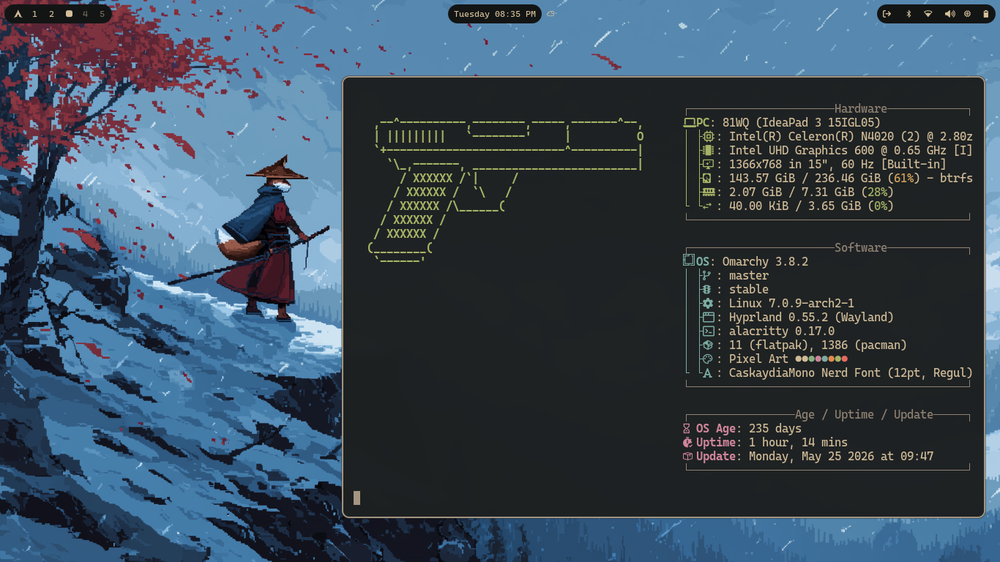

# Pixel Art Theme

A retro-inspired Omarchy theme that brings pixel-art aesthetics to your desktop. With nostalgic design elements, it captures the idea of classic 8-bit and 16-bit games and maintains everyday use.

## Color Palette

Based on a crafted dark palette:

| Role | Hex | Usage |
|---|---|---|
| Background | `#1D2021` | Base dark background |
| Foreground | `#D5C4A1` | Primary text |
| Red | `#CC241D` / `#EA6962` | Errors, destructive actions |
| Green | `#B8BB26` / `#A9B665` | Success |
| Yellow | `#D79921` / `#E78A4E` | Warnings |
| Blue | `#83A598` / `#7DAEA3` | Links, accents |
| Magenta | `#D3869B` | Secondary accent |
| Cyan | `#8EC07C` / `#89B482` | Information |
| Bright Text | `#EBDBB2` | High-contrast text |

## License

MIT
